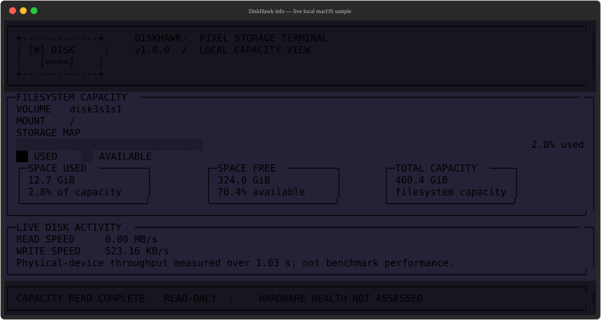
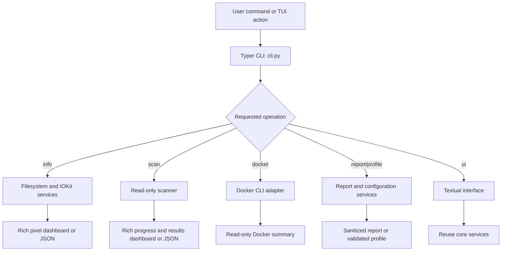
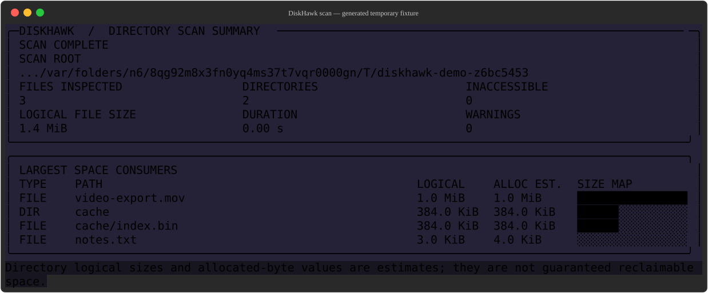

# DiskHawk — Project Report

**One line:** DiskHawk is a local-first macOS terminal tool for checking disk
capacity, finding large files, and producing privacy-conscious diagnostics.

**Team:** [RAJAT SONAR],[ABHAY DESHMUKH]  
**Repository:** <https://github.com/mca2026rajats/Linux-Terminal-tool-project-49-37->  
**Date:** 28-10-2026  
**Status:** Project-specific draft; first-person evidence and external tool
research still need the team's confirmation.

This report follows the supplied project template. Product and implementation
details below are based on the repository and commands actually run on this
Mac. Personal habits, teammate feedback, and research that has not been done
are explicitly left for the team rather than guessed.

## 1. The problem

### What we keep doing by hand

The local checks used while preparing this report were:

```bash
df -h .
du -sh .
diskutil info /
```

`df` reports filesystem capacity, `du` summarizes a directory, and `diskutil`
reports macOS volume/device details. These are separate views with different
levels of detail. DiskHawk puts common capacity and directory-size checks into
a consistent, read-only CLI and terminal dashboard.

**Personal workflow to confirm:** Replace or confirm the commands above with
the commands the team actually repeats. These commands were run for this
report; that alone does not establish that they are the team's regular
workflow.

### Evidence that is real

The following command output was collected from this Mac during report
preparation. It is a point-in-time observation, not shell-history evidence of
how often the workflow occurs:

```text
$ df -h .
Filesystem      Size    Used   Avail Capacity iused ifree %iused  Mounted on
/dev/disk3s5   460Gi   110Gi   324Gi    26%    947k  3.4G    0%   /System/Volumes/Data

$ du -sh .
87M     .
```

The `diskutil info /` check identified an APFS volume. A dashboard screenshot
with current local capacity and measured activity is included below; its
values can change and should be reviewed before sharing:



**Still required from the team:** A count from your own shell history and a
short explanation of how often the repeated task happens and how much time it
costs. Do not share full shell history; add only the count and a redacted
screenshot if your instructor requires one.

```text
# Example count command; adjust for the commands your team actually uses.
history | grep -E 'df|du|diskutil' | wc -l

History count: [paste your real output]
Frequency: [how often this happens]
Cost: [time or effort per occurrence]
```

### Who else has this problem

**Team input needed:** [State whether this affects only you or other classmates.
If you asked someone, identify them appropriately and summarize their actual
response. Do not invent a quote or interview.]

## 2. Prior art — what already exists

### Tools tried on this Mac

The macOS command-line utilities below were already installed with the
operating system, so no separate installation was needed. Each command was run
while preparing this report.

| Tool | Where found | What it does | Why it does not solve the whole DiskHawk use case |
|---|---|---|---|
| `df -h .` | macOS command line and local `df(1)` manual | Shows filesystem capacity and available space for the current directory's volume. | It does not show largest paths, a scan dashboard, separate live read/write rates, Docker usage, or a sanitized report. |
| `du -sh .` | macOS command line and local `du(1)` manual | Summarizes the apparent disk usage of a directory tree. | It does not provide filesystem capacity or a combined report, and one summary does not rank large files and directories in DiskHawk's dashboard. |
| `diskutil info /` | macOS command line and local `diskutil(8)` manual | Shows details about a selected macOS volume/device. | It is a lower-level volume view, not a unified directory scanner, Docker summary, report exporter, or interactive DiskHawk workflow. |

These are built-in system tools, not three third-party packages installed for
this assignment. No claim is made here that `ncdu`, `dust`, `duf`, or other
third-party disk analyzers were installed or tested.

### Evidence of trying them

For example, `df -h .` reported a 460 GiB filesystem, 110 GiB used, and 324 GiB
available at the time of the check. `du -sh .` reported 87 MiB for this
checkout. Those numbers describe different things: filesystem-wide capacity
versus the current directory's summary. `diskutil info /` identified the root
volume as APFS. The output changes with the machine and over time.

The gap established by these checks is limited to the built-in tools tested:
they provide useful individual views, but require the user to combine those
views and use other commands for ranked scans or reports. **A broader claim
that no existing tool solves this problem requires further prior-art research.**

### Where we searched

- [x] Local macOS manual pages: `man -k 'disk usage'`, and the `df`, `du`, and
  `diskutil` manuals.
- [ ] GitHub search for comparable disk-usage tools.
- [ ] Homebrew search and trial of a third-party tool.
- [ ] Stack Overflow search for the specific workflow.
- [ ] PyPI search for comparable Python CLI tools.
- [ ] Asked a human; add who and their actual response.

### The gap, in one sentence

The built-in macOS tools can report capacity, summarize directories, and show
volume details, but they do not combine the DiskHawk workflow—capacity, ranked
read-only scans, optional disk activity and Docker information, and
privacy-conscious reports—in one consistent CLI/TUI.

## 3. What we are building

### In scope

- Show filesystem capacity and measured macOS read/write throughput without
  recursively scanning directories for `diskhawk info`.
- Scan a selected directory without following symlinks by default; show the
  largest entries, logical sizes, available allocation estimates, progress,
  and partial-scan warnings.
- Provide optional read-only Docker usage inspection, a Textual terminal UI,
  and deterministic local phrase routing.
- Create sanitized diagnostic reports and validated configuration profiles.
- Support an explicitly installed, conflict-aware zsh/bash phrase integration.

### Out of scope

- Deleting files, emptying Trash, pruning Docker resources, stopping
  containers, or promising reclaimable space.
- Cloud upload, telemetry, user accounts, AI interpretation, a background
  daemon, or a graphical desktop app.
- Reading file contents, `.env` values, secrets, or container environment
  variables.

### How we will know it worked

This tool is successful if it turns separate capacity, volume, and directory
inspection commands into a small, tested `diskhawk` CLI/TUI workflow, reports
partial results honestly, and the team continues to use it after the
assignment. Verify the last part with actual team use rather than treating it
as already achieved.

## 4. Tech stack

| Choice | What we picked | Why this choice; what we rejected |
|---|---|---|
| Language | Python 3.12+ | Readable filesystem and CLI code with standard-library support; it is the project's implemented runtime. |
| Argument parsing | Typer | Typed commands, options, help, and validation; avoids maintaining a custom parser. |
| Terminal output | Rich | Tables, panels, progress, colors, and responsive terminal rendering. |
| Interactive UI | Textual | Keyboard- and mouse-driven terminal screens without introducing a desktop GUI. |
| Other dependencies | `platformdirs`; standard-library `pathlib`, `os`, `shutil`, `subprocess`, and `json` | Provides portable user paths and uses native/local APIs where possible; no unnecessary runtime dependencies. |
| Testing | pytest and pytest-cov | Exercises core logic, CLI, TUI, and integration behavior with mocked system readings where appropriate. |
| Lint and format | Ruff | One tool for the repository's configured lint and format checks. |
| Packaging / install | `pyproject.toml`, setuptools, and the `diskhawk` entry point | Supports editable development installs and normal Python package installation. |

### Why Python

Python is the implemented language and has standard-library filesystem,
subprocess, path, and JSON support needed for a local diagnostic utility. The
team's familiarity with Python can also reduce the effort required to maintain
and test the tool. The project does not claim that Python is universally better
than alternatives.

### What we are deliberately not using

The project does not use a pure Bash implementation: the typed CLI, tests,
structured reports, and Textual UI are more maintainable in Python. It also
does not use a web service, GUI framework, AI API, telemetry, or database.

## 5. Architecture



The CLI validates input and selects a service. Core modules obtain local
filesystem, macOS IOKit, or optional Docker data; presentation code turns the
results into terminal output. The TUI reuses core services rather than
implementing a separate scanner.

### Components

| Part | Responsibility | File |
|---|---|---|
| CLI | Commands, argument validation, output selection, and exit codes | [`src/diskhawk/cli.py`](./src/diskhawk/cli.py) |
| Filesystem summary | Mounted-filesystem capacity and selection | [`src/diskhawk/core/disk_info.py`](./src/diskhawk/core/disk_info.py) |
| Live disk activity | Separate macOS IOKit read/write counter sampling | [`src/diskhawk/core/disk_activity.py`](./src/diskhawk/core/disk_activity.py) |
| Directory scan | Safe traversal, sizing, progress, and partial-result handling | [`src/diskhawk/core/scanner.py`](./src/diskhawk/core/scanner.py) |
| Scan presentation | Live scan view and results/failure dashboards | [`src/diskhawk/presentation/scan_dashboard.py`](./src/diskhawk/presentation/scan_dashboard.py) |
| Storage presentation | Pixel-art capacity and activity dashboard | [`src/diskhawk/presentation/pixel_dashboard.py`](./src/diskhawk/presentation/pixel_dashboard.py) |
| Reports and profiles | Sanitization, report generation, and profile validation | [`src/diskhawk/core/reports.py`](./src/diskhawk/core/reports.py), [`src/diskhawk/config/profiles.py`](./src/diskhawk/config/profiles.py) |
| Interactive UI | Keyboard/mouse terminal interface using shared services | [`src/diskhawk/tui/`](./src/diskhawk/tui/) |

### Data flow

Filesystem capacity comes from the local `df` command and filesystem APIs;
macOS activity uses physical-device mappings and IOKit counter snapshots.
Directory scans use `os.scandir` and file metadata without opening file
contents. Docker information is requested only by an explicit Docker command or
report option. Results are formatted locally or emitted as JSON.

### What happens when things go wrong

| If this happens | The tool does this |
|---|---|
| A scanned file disappears or permissions prevent reading it | Continue where possible, count the error, mark the result partial, and report a warning. |
| The scan path is invalid or scanning `/` was not explicitly allowed | Show an actionable error and return a non-success exit status; do not silently scan another path. |
| macOS per-direction IOKit counters are unavailable or a device disappears | Display `N/A` with an explanation instead of fabricated throughput. |
| Docker is missing, stopped, or unreachable | Report the optional integration as unavailable; do not run destructive Docker commands. |

## 6. Usage

### Synopsis

```text
diskhawk [OPTIONS] COMMAND
diskhawk info [--all] [--include-network] [--threshold PERCENT] [--json]
diskhawk scan [PATH] [--top N] [--min-size SIZE] [--max-depth N]
              [--exclude GLOB]... [--allow-root] [--json]
```

### Commands and flags

| Command / flag | What it does | Default |
|---|---|---|
| `diskhawk --help` | Show available commands and options. | — |
| `diskhawk info` | Show capacity and measured read/write activity for relevant filesystems. | Current system values; about a one-second activity sample. |
| `diskhawk info --all` | List curated mounted filesystems. | Pseudo-filesystems are filtered. |
| `diskhawk info --include-network` | Include network mounts in the filesystem view. | Off. |
| `diskhawk info --threshold 85` | Set the capacity warning threshold (1–100%). | Configured threshold. |
| `diskhawk info --json` | Emit raw filesystem byte values as JSON without waiting for activity sampling. | Human-readable dashboard. |
| `diskhawk scan [PATH]` | Scan a directory without following symlinks. | Current directory (`.`). |
| `diskhawk scan PATH --top 10` | Limit the displayed largest entries. | Configured top count. |
| `diskhawk scan PATH --min-size 100MB` | Hide entries below the minimum size. | `0B`. |
| `diskhawk scan PATH --max-depth 3` | Limit traversal depth and mark incomplete totals. | Unlimited depth. |
| `diskhawk scan PATH --exclude '*.cache'` | Exclude matching basename or relative-path glob; repeatable. | No additional patterns. |
| `diskhawk scan PATH --allow-root` | Permit a scan of `/`; terminal use asks for confirmation. | Root scans are refused. |
| `diskhawk scan PATH --json` | Emit machine-readable scan results without animation. | Human-readable output. |
| `diskhawk docker` | Request read-only Docker disk usage for the active context. | Not queried by other commands unless explicitly requested. |
| `diskhawk report` | Create a sanitized local diagnostic report. | Text report. |
| `diskhawk profile show` | Show active non-secret configuration. | — |
| `diskhawk ui` | Launch the interactive Textual interface. | — |
| `diskhawk ask TEXT...` | Route a supported local phrase; unknown text is not executed. | — |
| `diskhawk shell install zsh` | Back up and add the opt-in zsh phrase integration after conflict checks. | Not installed. |
| `diskhawk shell uninstall zsh` | Back up and remove only the marked integration block. | — |

See the [command reference](./docs/commands.md) for all options and report and
profile subcommands.

### Examples

**Basic use** — `diskhawk info` uses live local filesystem and device data. The
screenshot below was rendered by the project's actual Rich dashboard on this
Mac; its values are point-in-time measurements.


**With a flag** — the scan screenshot was rendered by the same results renderer
against a temporary fixture containing three generated files. It demonstrates
the real layout without exposing project file names.

```bash
diskhawk scan . --top 10
```



**When it fails** — this invalid-option command was run against the actual CLI:

```text
$ diskhawk scan --nonsense
Usage: diskhawk scan [OPTIONS] [path]
Try 'diskhawk scan --help' for help.
Error: No such option: --nonsense
[exit status: 2]
```

### Exit codes

| Code | Meaning |
|---:|---|
| `0` | Success. |
| `1` | Operational or internal failure. |
| `2` | Invalid arguments or unsupported phrase. |
| `3` | Scan returned partial results. |
| `4` | Requested optional integration is unavailable. |

### Installation

Tested project setup and run commands:

```bash
git clone https://github.com/mca2026rajats/Linux-Terminal-tool-project-49-37-.git
cd Linux-Terminal-tool-project-49-37-
python3 -m venv .venv
source .venv/bin/activate
python -m pip install -e '.[dev]'
python -m pytest
diskhawk --help
diskhawk info
diskhawk scan . --top 10
```

To enable the exact shell phrase, run `diskhawk shell install zsh`, open a new
terminal, and type `give me disk info`. To remove the integration, run
`diskhawk shell uninstall zsh`. Bash integration is also available with the
corresponding `bash` argument. Review the project [run guide](./docs/GETTING_STARTED.md)
and [privacy notes](./docs/privacy.md) before sharing reports.

## 7. References

- [DiskHawk SRS and implementation plan](./DiskHawk_SRS_Implementation_Plan.md) —
  product scope, safety requirements, and implementation contract.
- [DiskHawk command reference](./docs/commands.md) — implemented CLI behavior
  and output semantics.
- [DiskHawk privacy documentation](./docs/privacy.md) — report sanitization,
  explicit detail opt-in, and scan limitations.
- macOS local manual pages `df(1)`, `du(1)`, and `diskutil(8)` — semantics of
  the built-in comparison commands checked on this machine.
- Repository source and tests — implementation behavior and tested output; see
  the component links in Section 5.

**Before submission:** Add real team names, personal history count and
frequency/cost evidence, teammate feedback, and results from any required
third-party tool trials. Those facts are not available in the repository and
are intentionally not fabricated in this draft.
