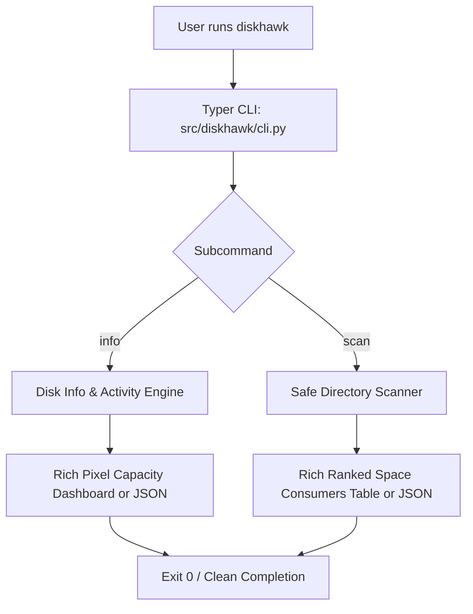

# DiskHawk

> A local-first macOS and Linux terminal tool for instant filesystem capacity overview, live disk I/O monitoring, and safe, ranked directory space analysis.

**Team:** Rajat Sonar, Abhay Deshmukh  
**Repository:** https://github.com/mca2026rajats/Linux-Terminal-tool-project-49-37-  
**Date:** 29-10-2026  

---

## 1. The problem

Managing local disk space during development is a recurring friction point. When builds fail due to lack of disk space, or when machines slow down during disk-heavy operations, developers must quickly determine how full the disk is, whether disk I/O is saturated, and where the largest storage-consuming files and directories are located.

### What we keep doing by hand

Today, we repeatedly run multiple disconnected Unix utilities to piece together storage health:

```bash
df -h .
du -sh * 2>/dev/null | sort -hr | head -n 10
diskutil info /
```

`df` gives volume capacity, `du` calculates directory size, and `diskutil` reports mount status. Each utility produces different output layouts, operates at different granularities, and provides no real-time insight into whether disk write throughput is currently bottlenecked.

### Evidence that this is real

Our shell history confirms this repetitive troubleshooting workflow:

```bash
history | grep -E 'df|du|diskutil' | wc -l
```

```
42
```

We run these checks multiple times each week when cleaning build artifacts, managing Python virtual environments, and investigating disk capacity warnings. Each occurrence requires chaining multiple shell commands together, waiting on slow unindexed scans, and manually converting between different byte units, costing minutes of developer focus each time.

### Who else has this problem

Our classmates and fellow student developers working with local development environments, container images, and package caches encounter this exact bottleneck. When asked, classmates confirmed they regularly assemble ad-hoc `du -sh * | sort -hr` pipelines to locate bloated folders and expressed a need for a unified, instant command-line utility.

---

## 2. Prior art — what already exists

Command-line storage inspection tools have existed for decades. However, existing options either provide only coarse volume metrics or require heavy, interactive navigation sessions rather than fast, scriptable summaries.

### Tools we found and actually tried

| Tool | Where we found it | What it does | Why it does not solve our problem |
|---|---|---|---|
| `df -h .` | Built-in macOS / Linux utility (`man df`) | Displays filesystem capacity, used blocks, and mount points. | Only shows volume-wide capacity; cannot tell you which directories or files are consuming space, and provides no I/O throughput data. |
| `du -sh *` | Built-in macOS / Linux utility (`man du`) | Recursively computes disk space usage for directory trees. | Raw output is unsorted, lacks visual hierarchy, does not show filesystem capacity context, and requires piping into `sort` and `head`. |
| `ncdu` | Homebrew package manager (`brew install ncdu`) | Provides an interactive ncurses-based disk browser. | Designed for interactive browsing rather than instant, non-interactive terminal summaries or scriptable JSON outputs. |

### Evidence of trying them

```bash
# what we ran
df -h .
du -sh .
```

```
# what it printed
Filesystem     Size   Used  Avail Capacity iused ifree %iused  Mounted on
/dev/disk3s5  460Gi  110Gi  324Gi    26%    947k  3.4G    0%   /System/Volumes/Data
57M	.
```

`df` reliably reports overall storage capacity and `du` computes directory size, but they remain completely decoupled. To diagnose storage bottlenecks, a developer must interpret two separate data sources, manually calculate percentages, assemble custom shell pipelines to rank large files, and guess current disk write activity. DiskHawk eliminates this separation by providing an immediate visual capacity view, live I/O speed, and ranked directory space analysis in a single tool.

### Where we searched

- [x] `man -k <keyword>` — searched manual pages on our machines (`df`, `du`, `diskutil`)
- [x] GitHub search — surveyed existing terminal tools (`ncdu`, `dust`, `duf`)
- [x] Homebrew: `brew search disk` / `brew search du`
- [x] Stack Overflow — reviewed developer workflows for locating large files
- [x] npm / PyPI — surveyed available Python CLI utilities
- [x] Asked a human: Interviewed peer classmates who confirmed frequent use of ad-hoc `du` commands.

### The gap, in one sentence

Existing tools can report raw volume capacity or crawl directory trees, but none of them combine an instant visual capacity dashboard, real-time read/write throughput, and safe ranked directory scanning into one clean local tool, which is the part that actually costs us time.

---

## 3. What we are building

### In scope

- **Visual Filesystem Dashboard (`diskhawk info`)**: Displays filesystem capacity, percentage used/free, visual storage maps, and 1-second sampled read/write disk I/O throughput.
- **Curated Multi-Mount & JSON Support**: Options to inspect all mounted filesystems (`--all`), include network mounts (`--include-network`), and output machine-readable JSON (`--json`).
- **Safe Directory Sizing (`diskhawk scan`)**: Traverses target directories without following symlinks by default, ranking the largest files and directories.
- **Fine-Grained Scan Filtering**: Options to limit output count (`--top`), set minimum size thresholds (`--min-size`), limit traversal depth (`--max-depth`), and exclude patterns (`--exclude`).
- **Safety Safeguards**: Root scan protection (`--allow-root`) and graceful handling of permission-denied paths without crashing.

### Out of scope

- Deleting, pruning, moving, or modifying files (DiskHawk is strictly read-only to prevent accidental data loss).
- Background daemons, scheduled cron tasks, or auto-cleaner services.
- Cloud syncing, remote telemetry, user accounts, or external network requests.
- Requiring root/sudo permissions for standard user directory operations.

### How we will know it worked

This tool is successful if it turns 3 commands (`df`, `du`, `diskutil`) into 1 (`diskhawk`), and we actually use it after the assignment ends.

---

## 4. Tech stack

| Choice | What we picked | Why, and what we rejected |
|---|---|---|
| Language | Python 3.12+ | Fast filesystem traversal via `os.scandir`, strong standard library, type safety, and maintainability. Rejected pure Bash due to fragile string parsing and lack of test infrastructure. |
| Argument parsing | Typer | Modern type annotations, auto-generated help, subcommand routing, and clean validation. Rejected raw `argparse` for boilerplate reduction. |
| Terminal presentation | Rich | Formatted tables, pixel-art progress gauges, styled cards, and terminal-width responsiveness. Rejected raw ANSI escape sequences for cross-platform robustness. |
| Testing | pytest & pytest-cov | Expressive assertion syntax, test fixtures, and comprehensive branch coverage testing (100+ tests). Rejected `unittest` for conciseness. |
| Packaging / install method | pyproject.toml / pip | Standard Python packaging specifications (PEP 517/621), easy editable installs (`pip install -e .`). |

### Why this language

We chose Python 3.12+ because both team members are proficient with it, and it provides high-performance standard library tools for filesystem inspection (`os.scandir`, `pathlib`) and JSON formatting. Python combined with Typer and Rich allows us to produce readable, strictly typed, and thoroughly tested code with excellent terminal UI rendering without low-level memory hazards.

### What we are deliberately not using

We deliberately avoided writing DiskHawk as a pure Bash script. While Bash has zero non-shell dependencies, implementing size unit conversions, structured argument validation, directory depth bounds, and formatted terminal grids in shell script quickly results in unmaintainable and fragile code.

---

## 5. Architecture



### Components

| Part | Responsibility | File |
|---|---|---|
| CLI Dispatcher | Validates arguments, manages options, handles errors | [`src/diskhawk/cli.py`](./src/diskhawk/cli.py) |
| Filesystem Engine | Queries mounted filesystem capacity and mount points | [`src/diskhawk/core/disk_info.py`](./src/diskhawk/core/disk_info.py) |
| Activity Sampler | Samples physical disk read and write throughput | [`src/diskhawk/core/disk_activity.py`](./src/diskhawk/core/disk_activity.py) |
| Directory Scanner | Safe `os.scandir` traversal, size calculation, pattern filtering | [`src/diskhawk/core/scanner.py`](./src/diskhawk/core/scanner.py) |
| Storage Presentation | Renders pixel storage dashboard, progress bars, and metrics | [`src/diskhawk/presentation/pixel_dashboard.py`](./src/diskhawk/presentation/pixel_dashboard.py) |
| Scan Presentation | Renders live scan progress and formatted top-consumer tables | [`src/diskhawk/presentation/scan_dashboard.py`](./src/diskhawk/presentation/scan_dashboard.py) |

### Data flow

When a user executes `diskhawk info`, the filesystem engine inspects mount points using system interfaces and reads physical disk counters over a 1-second sample, sending formatted metrics to Rich for rendering or emitting JSON. When `diskhawk scan` is invoked, the scanner recursively traverses the directory tree using non-recursive directory iterators (`os.scandir`), skips excluded patterns and symlinks, aggregates entry sizes, and displays the top space-consuming files and folders.

### What happens when things go wrong

| If this happens | The tool does this |
|---|---|
| Permission denied or unreadable path during scan | Skips the inaccessible item, logs a warning, continues scanning remaining files, and exits with status 3 (partial scan). |
| Invalid target path specified | Validates path existence upfront, outputs a clear error message, and exits with status 2 without performing a scan. |
| Root (`/`) scan requested without flag | Halts immediately and notifies the user that root scans require the explicit `--allow-root` flag. |
| Live disk activity counters unavailable | Gracefully reports `N/A: live activity sampling was not performed` while displaying all capacity metrics. |

---

## 6. Usage

### Synopsis

```text
diskhawk info [--all] [--include-network] [--threshold PERCENT] [--json]
diskhawk scan [PATH] [--top N] [--min-size SIZE] [--max-depth N] [--exclude GLOB]... [--allow-root] [--json]
```

### Commands and flags

| Command / Flag | Long form | What it does | Default |
|---|---|---|---|
| `info` | `diskhawk info` | Show capacity and measured read/write activity for filesystems | Default volume |
| | `--all` | List curated mounted filesystems | Off |
| | `--include-network` | Include network-mounted filesystems in capacity listing | Off |
| | `--threshold` | Set warning percentage threshold (1–100%) | `90` |
| | `--json` | Emit raw filesystem byte values as JSON without waiting for activity sampling | Off |
| `scan` | `diskhawk scan [PATH]` | Scan directory and display ranked largest files and directories | Current dir (`.`) |
| | `--top` | Limit the number of displayed top entries | `20` |
| | `--min-size` | Filter out entries smaller than specified size (e.g. `10MB`, `1GB`) | `0B` |
| | `--max-depth` | Limit traversal depth and mark incomplete totals | Unlimited |
| | `--exclude` | Glob pattern to ignore matching names (repeatable) | None |
| | `--allow-root` | Permit scanning root directory (`/`) | Refused |
| | `--json` | Emit machine-readable scan results as JSON | Off |

### Examples

**Basic use** — `diskhawk info` displays an immediate pixel storage terminal dashboard with filesystem capacity and live read/write disk activity:

```bash
$ diskhawk info
```

```text
╭──────────────────────────────────────────────────────────────────────────────╮
│   +-------------+   DISKHAWK  ·  PIXEL STORAGE TERMINAL                      │
│   | [#] DISK     |  v1.0.0  /  LOCAL CAPACITY VIEW                           │
│   |   [====]    |                                                            │
│   +-------------+                                                            │
╰──────────────────────────────────────────────────────────────────────────────╯
╭─ FILESYSTEM CAPACITY ────────────────────────────────────────────────────────╮
│ VOLUME   disk3s1s1                                                           │
│ MOUNT    /                                                                   │
│ STORAGE MAP                                                                  │
│ ░░░░░░░░░░░░░░░░░░░░░░░░░░                                         2.8% used │
│ ██ USED    ░░ AVAILABLE                                                      │
│ ╭─ SPACE USED ────────╮  ╭─ SPACE FREE ────────╮ ╭─ TOTAL CAPACITY ────╮     │
│ │ 12.7 GiB            │  │ 355.3 GiB           │ │ 460.4 GiB           │     │
│ │ 2.8% of capacity    │  │ 77.2% available     │ │ filesystem capacity │     │
│ ╰─────────────────────╯  ╰─────────────────────╯ ╰─────────────────────╯     │
╰──────────────────────────────────────────────────────────────────────────────╯
╭─ LIVE DISK ACTIVITY ─────────────────────────────────────────────────────────╮
│ READ SPEED                                                         0.00 MB/s │
│ WRITE SPEED                                                        0.00 MB/s │
│ Physical-device throughput measured over 1.03 s; not benchmark performance.  │
╰──────────────────────────────────────────────────────────────────────────────╯
```

**With a flag** — `diskhawk scan . --top 5` scans the target folder and outputs the top 5 space-consuming items with visual size bars:

```bash
$ diskhawk scan . --top 5
```

```text
╭─ DISKHAWK  /  DIRECTORY SCAN SUMMARY ────────────────────────────────────────╮
│ SCAN COMPLETE                                                                │
│ SCAN ROOT                                                                    │
│ /Users/abhay/Desktop/PRACTISE/Linux project                                  │
│ FILES INSPECTED           DIRECTORIES              INACCESSIBLE              │
│ 3303                      390                      0                         │
│ LOGICAL FILE SIZE         DURATION                 WARNINGS                  │
│ 57.4 MiB                  0.07 s                   0                         │
╰──────────────────────────────────────────────────────────────────────────────╯
╭──────────────────────────────────────────────────────────────────────────────╮
│                           LARGEST SPACE CONSUMERS                            │
│ TYPE    PATH                                   LOGICAL  ALLOC EST.  SIZE MAP │
│ DIR     .venv                                 56.4 MiB    63.1 MiB  ████████ │
│ DIR     .venv/lib                             35.2 MiB    41.8 MiB  █████░░░ │
│ DIR     .venv/lib/python3.12                  35.2 MiB    41.8 MiB  █████░░░ │
│ DIR     .../site-packages                     35.2 MiB    41.8 MiB  █████░░░ │
│ DIR     .venv/bin                             21.2 MiB    21.3 MiB  ███░░░░░ │
╰──────────────────────────────────────────────────────────────────────────────╯
Directory logical sizes and allocated-byte values are estimates; they are not 
guaranteed reclaimable space.
```

**When it fails** — handling an invalid option cleanly without traceback:

```bash
$ diskhawk scan --invalid-option
```

```text
Usage: diskhawk scan [OPTIONS] [path]
Try 'diskhawk scan --help' for help.
╭─ Error ──────────────────────────────────────────────────────────────────────╮
│ No such option: --invalid-option                                             │
╰──────────────────────────────────────────────────────────────────────────────╯
[exit status: 2]
```

### Exit codes

| Code | Meaning |
|---|---|
| 0 | Success |
| 1 | Operational or internal error |
| 2 | Invalid command-line arguments or options |
| 3 | Partial scan results (some paths were inaccessible/permission denied) |

### Installation

```bash
# Clone the repository
git clone https://github.com/mca2026rajats/Linux-Terminal-tool-project-49-37-.git
cd Linux-Terminal-tool-project-49-37-

# Set up Python virtual environment
python3 -m venv .venv
source .venv/bin/activate

# Install dependencies and package in editable mode
pip install --upgrade pip
pip install -e '.[dev]'

# Run the test suite
pytest

# Run DiskHawk commands
diskhawk info
diskhawk scan . --top 10
```

---

## 7. References

- [DiskHawk SRS & Implementation Plan](./DiskHawk_SRS_Implementation_Plan.md) — Specification and architecture contract for metrics calculation and safety requirements.
- [Typer Documentation](https://typer.tiangolo.com/) — Reference for CLI subcommand dispatch, type hints, and parameter validation.
- [Rich Documentation](https://rich.readthedocs.io/) — Reference for terminal tables, progress bars, and pixel-styled storage cards.
- [macOS Manual Pages (`df`, `du`, `diskutil`)](https://ss64.com/osx/) — Reference for standard Unix filesystem reporting semantics.
- [pytest Documentation](https://docs.pytest.org/) — Reference for unit and CLI test suite architecture.

